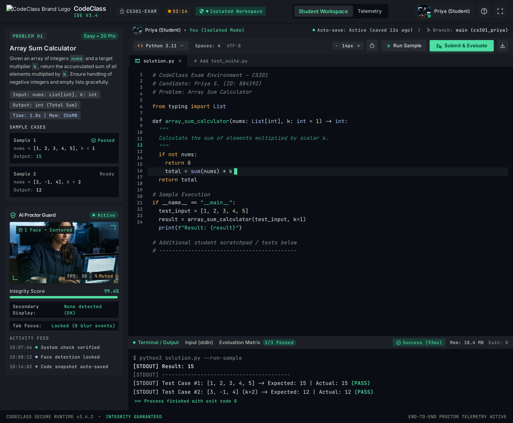
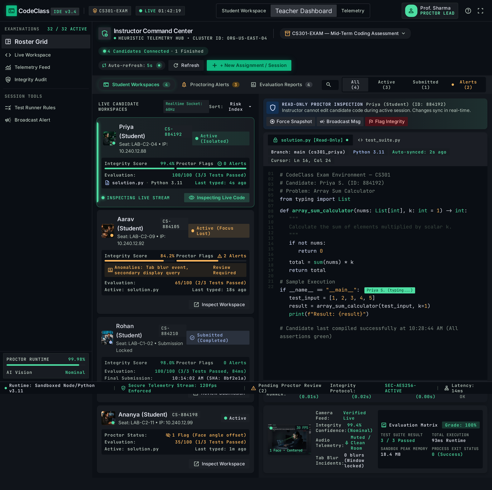

# Major Project Report — CodeClass

**Title:** CodeClass – Real-Time Collaborative Coding and Online Proctoring Platform  
**Course:** 7th-Semester B.Tech Computer Science & Engineering  
**Repository:** https://github.com/ojaswishivam/CodeCollab.git

---

## 1. Problem Statement & Architectural Evolution

### Original Technical Limitation
A single shared editing room allows multiple users to mutate the same buffer simultaneously. In an educational or examination setting, if User A writes `x = 10` and User B writes `x = 20`, concurrent updates create write-write conflicts or overwrite each student's independent work.

### Revised CodeClass Architecture
- **Teacher Dashboard:** Creates assignments/assessments (with configurable test duration, language, proctoring, and test cases) and manages classroom sessions.
- **Classroom Session Server:** Assigns each student an independent document (`{sessionCode}__student__{studentId}`) during assessments, while allowing intentional multi-user CRDT collaboration (`{sessionCode}__shared`) in group labs.
- **Role-Based Access Control:** Teachers inspect student documents in strict read-only mode (via a one-way `ytext.observe` mirror in `TeacherDashboard.tsx` and WebSocket role validation in `server.ts`) without overwriting student code.
- **Per-Tab Session Isolation:** Auth state uses `sessionStorage` so instructors and students can test or operate simultaneously in different tabs of the same browser.
- **Central Evaluation & Monitoring Server:** Collects proctoring activity logs, submissions, automated test-case evaluations, similarity checks, and CSV exports.

---

## 2. UI/UX Preview (Precision Proctor IDE)

### Student Assessment Workspace

### Teacher Instructor Command Center

---

## 3. Implemented Modules

### Module 1: Role-Based Auth & Session Management
- JWT + bcryptjs authentication (`server/src/routes/auth.ts`) supporting `teacher` and `student` roles.
- Session & workspace APIs (`server/src/routes/sessions.ts`) with pre-seeded assessment (`CS301-EXAM`) and collaborative lab (`COLLAB-101`).
- Streamlined top navigation (`Student Workspace` and role-gated `Teacher Dashboard`).

### Module 2: Isolated Workspaces & CRDT Synchronization
- Independent student Monaco + Yjs workspaces (`client/src/components/CollabEditor.tsx`).
- One-way live read-only inspector (`client/src/components/TeacherDashboard.tsx`) synced to the active session's `yjsRoomId` (`__student__` or `__shared`).
- Exam countdown timer with 5-minute warning and auto-submission on expiry.

### Module 3: Consent-Based Proctoring & AI Vision Module
- Transparent student consent before enabling webcam and full-screen monitoring (`client/src/components/ProctoringMonitor.tsx`).
- Tracks webcam face presence (`no_face`), `multiple_faces`, `head_pose_away`, `tab_switch`, `fullscreen_exit`, `copy_paste`, and `inactivity`.
- Displays live **Integrity Score**, **Tab Focus** blur count, and **Full-Screen Lock** status.
- Activity logs (`server/src/routes/proctoring.ts`) are surfaced in the Teacher Dashboard as review alerts, never automatic proof of cheating.

### Module 4: Sandboxed Multi-Language Execution
- Supports Python 3, JavaScript (Node.js), and C++ (GCC) with 5-second timeout protection and Docker container isolation (`docker/sandbox-*`, `server/src/execution/runner.ts`).

### Module 5: Automated Code Evaluation & Reporting
- Evaluates submissions against predefined visible and hidden test cases (`server/src/routes/evaluate.ts`).
- Generates structured performance reports (`client/src/components/EvaluationReportModal.tsx`) showing Compilation status, Test cases passed (`e.g. 10/10`), Execution time (`sec`), and Score (`0–100`).
- Includes pairwise token similarity alerts and CSV export for proctoring logs and evaluation reports in `TeacherDashboard.tsx`.
