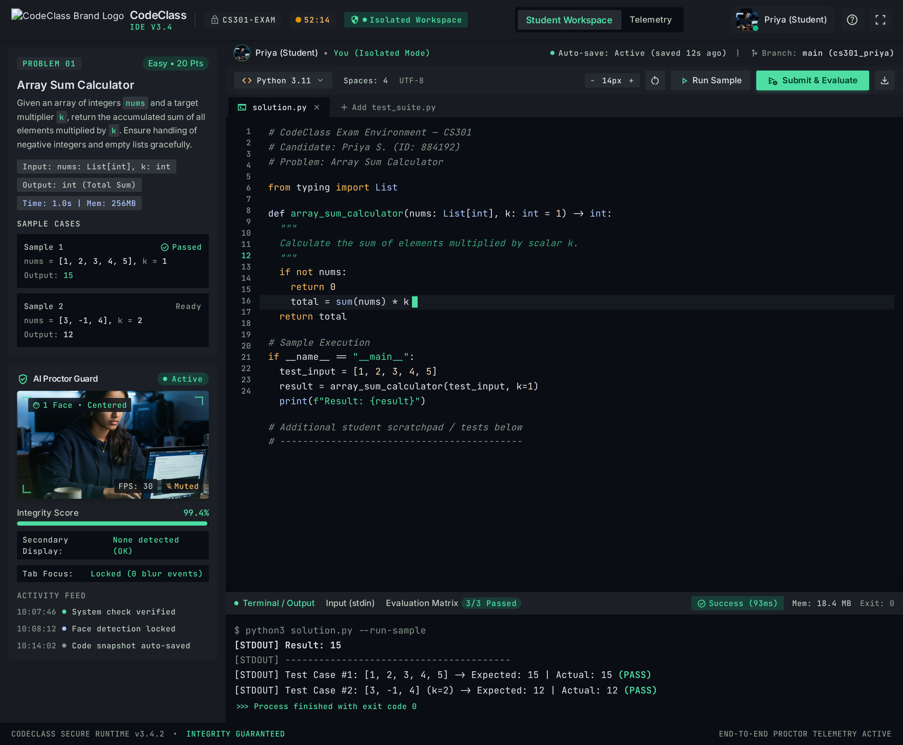
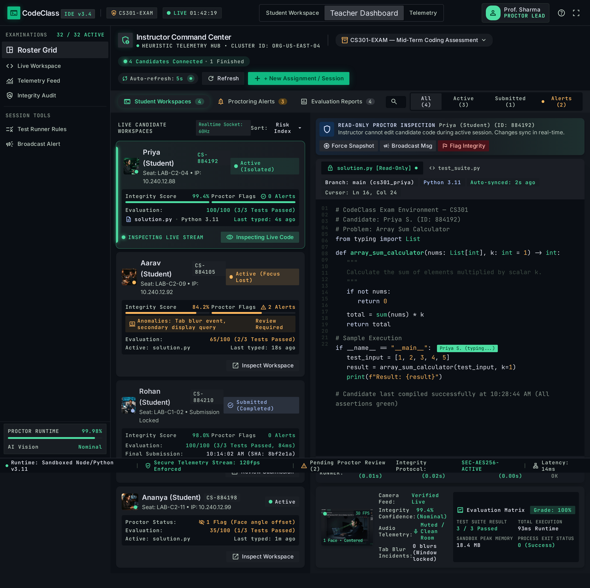

# CodeClass — Real-Time Collaborative Coding & Online Proctoring Platform

> **7th-Semester B.Tech CSE Major Project**  
> Role-Based Classroom & Exam IDE with Isolated Student Workspaces, Consent-Based AI Proctoring, Automated Code Evaluation, and CRDT Collaboration.

---

## Screenshots

### Student Assessment Workspace (Precision Proctor IDE)


### Teacher Instructor Command Center (Read-Only Live Inspection)


---

## Key Architecture: Solving Write-Write Conflicts

In a naive shared editor, multiple students editing the same document simultaneously cause write-write conflicts or overwrite each other's solutions. **CodeClass** resolves this with a dual-mode, role-controlled architecture:

- **Assessment Mode (Isolated Student Workspaces):** Each student (`Student A`, `Student B`, `Student C`) receives an independent Yjs document (`{sessionCode}__student__{studentId}`). Students never overwrite one another, while teachers inspect any student's live workspace in **strict read-only mode** via a one-way `ytext` observer and server-side WebSocket update filtering.
- **Collaborative Mode (Shared CRDT Lab):** When multiple users are intentionally authorized to pair-program on one document (`{sessionCode}__shared`), Yjs CRDTs synchronize concurrent edits conflict-free.
- **Per-Tab Session Isolation:** Authentication tokens and user profiles use per-tab `sessionStorage`, allowing Teacher and Student sessions to run side-by-side in separate browser tabs without overwriting each other on reload.

---

## Core Modules

1. **Teacher Dashboard (`client/src/components/TeacherDashboard.tsx`):**
   - Create exam sessions with quick **Test Duration** presets (`15m`, `30m`, `45m`, `60m`, `90m`, `120m`) + `-5`/`+5` stepper, custom problem statements, starter code, AI proctoring toggle, and predefined visible/hidden test cases.
   - Inspect live student workspaces in real-time read-only mode (supports both `assessment` and `collaborative` rooms).
   - Review timestamped proctoring alerts, pairwise code similarity alerts ($\ge 70\%$ token similarity), and automated evaluation reports with **CSV export**.
2. **Consent-Based AI Proctoring (`client/src/components/ProctoringMonitor.tsx`):**
   - Transparent consent prompt before activating webcam & full-screen monitoring.
   - Real-time face presence (`no_face`), multiple face detection (`multiple_faces`), and head-pose estimation (`head_pose_away`).
   - Live **Integrity Score** progress bar, **Tab Focus** blur counter, and **Full-Screen Lock** status.
   - Behavioral tracking: tab-switch detection, full-screen exit detection, copy-paste logging, and inactivity detection.
   - All signals are recorded as alerts for instructor review, not automatic proof of cheating.
3. **Automated Code Evaluation (`server/src/routes/evaluate.ts`, `server/src/execution/runner.ts`):**
   - Executes Python 3, JavaScript (Node.js), and C++ (GCC) in Docker sandboxes (or isolated local fallback).
   - Runs predefined visible and hidden test cases, reports compilation errors, calculates scores (`passedCount / totalCount`), measures execution time, and generates individual performance reports (`client/src/components/EvaluationReportModal.tsx`).
4. **Exam Countdown Timer & Auto-Submit (`client/src/components/CollabEditor.tsx`):**
   - Persistent per-student exam countdown timer (`MM:SS`) with 5-minute warning and automatic submission on expiry.

---

## Running Locally

### 1. Start Backend (`server/`)
```powershell
cd server
npm install
npm run dev
```
Runs on `http://localhost:1234` and `ws://localhost:1234`.

### 2. Start Frontend (`client/`)
```powershell
cd client
npm install
npm run dev
```
Runs on `http://localhost:5173`.

### 3. Demo Accounts
- **Teacher:** `teacher@codeclass.io` / `password123`
- **Student A:** `student1@codeclass.io` / `password123`
- **Student B:** `student2@codeclass.io` / `password123`
